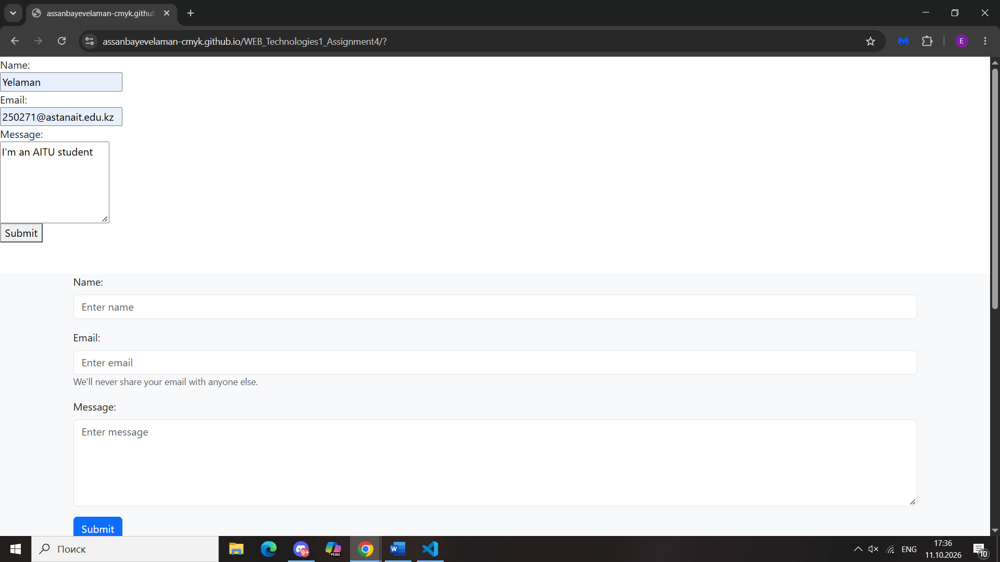
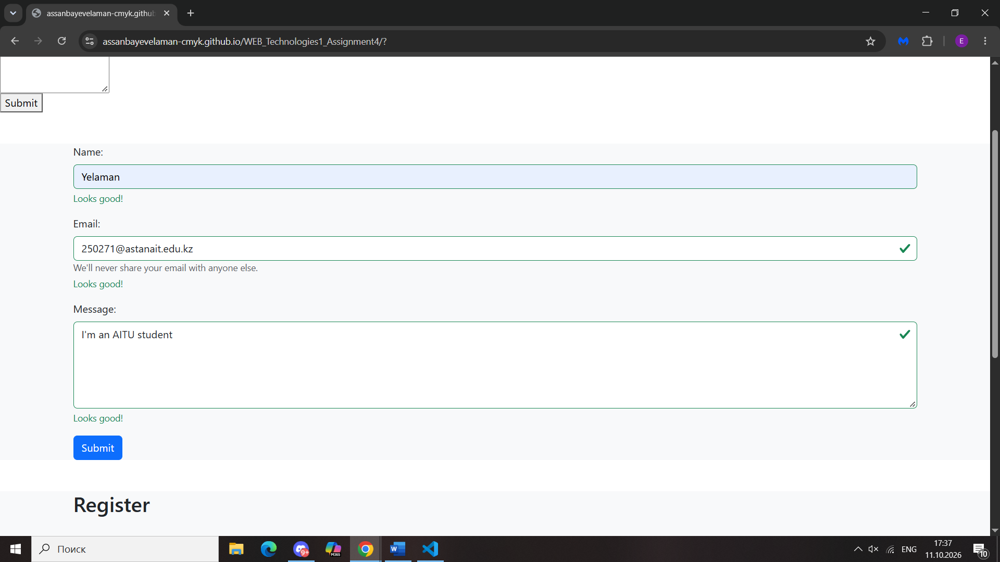
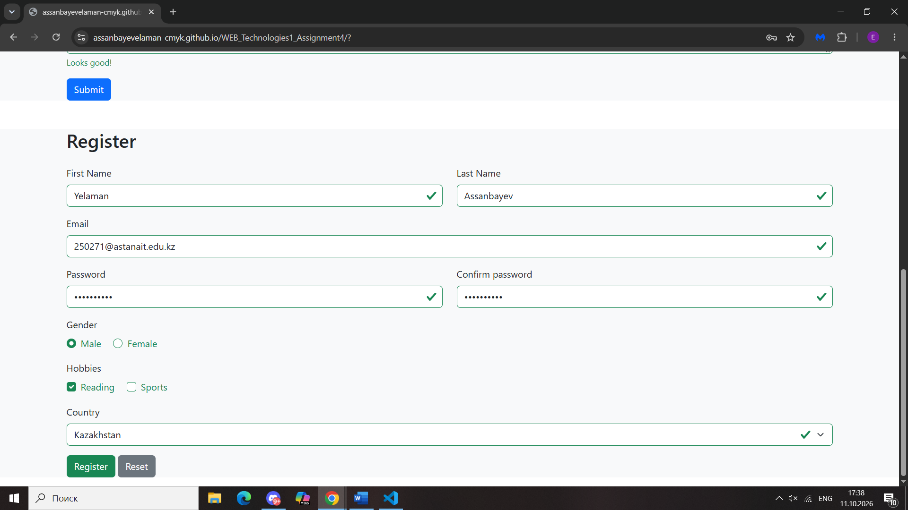

# WEB_Technologies1_Assignment4

**Name:** Assanbayev Yelaman  
**Group:** SE-2538

## Part 1. Basic HTML Forms

Plain HTML forms with Name, Email and Message fields.
Every field has a proper `<label>` and validation attributes.

## Part 2. Bootstrap Forms

Recreated the contact form using Bootstrap classes. Addede placeholders and helper text.
Added `valid-feedback`/`invalid-feedback` messages.

## Part 3. Advanced Form Project

Created a registration form with First Name, Last Name, Email, Password + Confirm Password, Gender (radio button), Hobbies (checkboxes), Country (select dropdown), and Submit/Reset buttons. Styled with Bootstrap Grid, added HTML5 validation, added Bootstrap validation feedback.

## Summary

I built the plain HTML contact form first. I recreated it with Bootstrap. I added validation feedback classes. I built the full registration form with responsive grid and password match.
